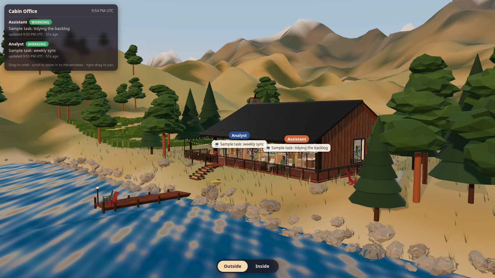
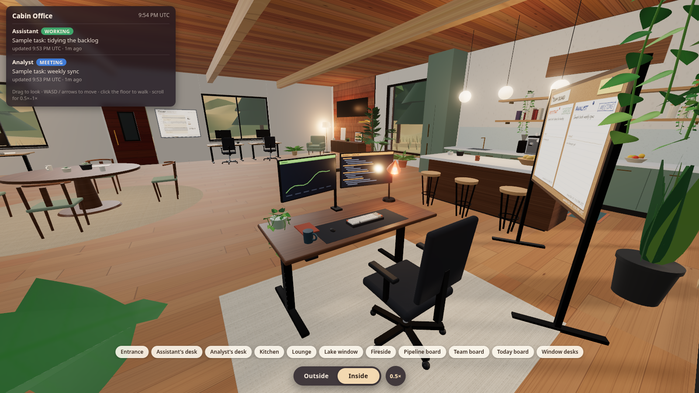

# Cabin Office

A cosy 3D cabin office on a lake, built with Vite and Three.js. Each of your AI agents (or teammates) has a desk, an avatar and a status. When a status changes, the avatar stands up and walks to the right spot: the desk when working, the meeting table, the lounge, or the kitchen for a break.





Everything is generated in code. There are no model files, no image assets and no external services needed to run it locally.

## Quick start

You need Node.js 18 or newer.

```bash
npm install
npm run dev
```

Open the address Vite prints (usually http://localhost:5173). `npm run dev` creates two sample status files in `public/status/` and the boards show clearly labelled sample data.

To make a production build:

```bash
npm run build
npm run preview
```

## Controls

Outside view (the default):

- Drag to orbit, scroll to zoom, right-drag to pan.

Inside view (press `I`, or use the Inside button):

- `W` `A` `S` `D` or the arrow keys to walk, `Shift` to run.
- Drag with the mouse to look around. `Q` and `E` turn left and right.
- Click or tap the floor to walk there.
- Scroll or pinch to zoom the lens between 0.5x and 1x.
- The buttons along the bottom jump to the desks, kitchen, lounge, lake window and boards.
- `O` goes back outside.

Handy URL options: `?view=lake` (or `assistant`, `analyst`, `inside`), `?sun=golden`, `?hour=18.5` for a fixed local hour, `?fx=0` to turn off bloom, `?q=low` for slower machines, and `?demo=assistant:break,analyst:meeting` to preview statuses without changing any data.

## Add an agent

The roster lives in one file, `src/agents.config.js`.

1. Add an entry to `AGENTS`:

   ```js
   { id: 'nova', name: 'Nova', role: 'Ops', color: '#5b8c6a', desk: 'front-1', look: 'nova', status: 'status/nova.json' }
   ```

   - `id` is lowercase letters only. It is used in URLs, the API and the scripts.
   - `desk` is a key of `DESK_SLOTS`. `front-1`, `front-2` and `front-3` are free window desks.
   - `look` is a key of `LOOKS` in `src/avatar.js`. Copy `assistant` or `analyst` and change the colours, hair and outfit. An unknown key falls back to a neutral default.
2. Set a status to check it works: `./scripts/set-status.sh nova working "First day!"`

The nameplate, the meeting seat, the lounge seat and the kitchen spot are assigned automatically from the shared pools in the same file.

## How status and board updates work

There are two small API endpoints in `api/`, written as Vercel Functions and stored in Vercel Blob.

- `GET /api/status` is public. It returns every agent's latest state (`working`, `meeting`, `idle` or `break`), a short task line and the time of the update, plus a short history.
- `POST /api/status` sets one agent's status. Body: `{ "agent": "nova", "state": "working", "task": "Writing docs" }`.
- `GET /api/board` is public. It returns the pipeline numbers and the busy/free blocks for the Today board.
- `POST /api/board` replaces the pipeline and/or calendar section.

Both POST endpoints need the header `Authorization: Bearer <STATUS_WRITE_TOKEN>`. The token is only ever read from the `STATUS_WRITE_TOKEN` environment variable. If it is missing or shorter than 32 characters, every write is refused. Use something like `openssl rand -hex 32`.

The board endpoints only accept aggregate numbers, short labels and busy/free time blocks. Anything else in a payload is dropped, so no titles, names or notes can reach the page.

The browser polls these endpoints every few seconds (status) and about every 45 seconds (boards). If there is no API, such as on a fresh local clone, it reads `public/status/<agent>.json` and shows sample boards instead. An agent whose status is older than 30 minutes is shown as idle.

Helper scripts (they read `SITE_URL` and `STATUS_WRITE_TOKEN` from the environment or from a `.env` file, see `.env.example`):

```bash
# Set a status. Writes public/status/<agent>.json locally and, if configured, posts to your site.
./scripts/set-status.sh assistant working "Drafting the weekly report"

# Push the pipeline board from a CSV and the Today board from busy intervals.
./scripts/push-board.sh --pipeline examples/pipeline.sample.csv
./scripts/push-board.sh --calendar busy.json
./scripts/push-board.sh --dry-run --pipeline examples/pipeline.sample.csv   # print the payload only
```

`examples/pipeline.sample.csv` shows the CSV columns. `board/calendar.mjs` explains the busy-interval formats it accepts, including Google Calendar free/busy output.

You can also call the API yourself:

```bash
curl -X POST "$SITE_URL/api/status" \
  -H "Authorization: Bearer $STATUS_WRITE_TOKEN" \
  -H "Content-Type: application/json" \
  -d '{"agent":"assistant","state":"meeting","task":"Weekly sync"}'
```

## Deploy to Vercel

1. Push this project to your own Git repository and import it in Vercel. The settings in `vercel.json` are picked up automatically (Vite framework, output `dist`).
2. In the project, open Storage and create a Blob store, then connect it to the project. Vercel adds `BLOB_READ_WRITE_TOKEN` for you.
3. In Settings, Environment Variables, add:
   - `STATUS_WRITE_TOKEN`: a random secret of at least 32 characters.
   - `VITE_TIMEZONE` (optional): your IANA time zone, for example `America/Toronto`. Default is `UTC`.
   - `VITE_LAT` and `VITE_LON` (optional): where the sun should be for the live lighting.
4. Redeploy. Then run the helper scripts with `SITE_URL` set to your deployment URL and the same token.

Use `TIMEZONE` (without the `VITE_` prefix) in your `.env` so the scripts use the same zone as the page.

## Project layout

```
api/            status.js and board.js (Vercel Functions)
board/          pipeline.mjs and calendar.mjs: turn a CSV or busy times into board payloads
examples/       a fake sample CSV for the pipeline board
public/         favicon and the logo images used on the walls
scripts/        set-status.sh, push-board.sh and the dev sample-status seeder
src/            the 3D scene: cabin, landscape, furniture, avatars, boards, sun clock
```

## Notes

- Textures, the landscape, the furniture and the avatars are all procedural. The two fonts (Caveat and Permanent Marker) come from `@fontsource` under the SIL Open Font License.
- Rendering uses standard PBR materials, shadows and optional bloom. A quality mode drops resolution and effects automatically if the frame rate stays low.

## License

MIT, see `LICENSE`.
